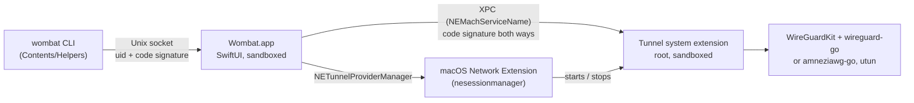

# Architecture

How Wombat is built, where secrets live, and what each part trusts.

## Contents

- [Components](#components)
- [Where secrets live](#where-secrets-live)
- [Trust boundaries](#trust-boundaries)
- [Leak protection](#leak-protection)
- [Updates](#updates)
- [Untrusted input](#untrusted-input)
- [Changes to the vendored engine](#changes-to-the-vendored-engine)

## Components

| Part | Runs as | Holds |
|---|---|---|
| `App/` (Wombat.app) | you, App Sandbox | UI, your keychain copy of each config, CLI control socket |
| `Tunnel/` (system extension) | root, App Sandbox | the packet tunnel, its own root-only copy of each config |
| `CLI/` (`wombat`) | you | nothing; asks the app, or works offline (`check`, `genkey`) |
| `Packages/TunnelCore` | (library) | wg-quick parser, validation, review, stats, the CLI protocol |

One Go library (`libwg-go.a`) holds two engines: upstream wireguard-go for WireGuard tunnels and
a vendored amneziawg-go for tunnels with active AmneziaWG settings (`awgTurnOn`). The choice is
made per tunnel from its config, so plain WireGuard never runs the fork's code. Both share one
handle table and one patched Go runtime.

The extension is a **system extension** because Network Extension providers distributed outside
the Mac App Store must be. It activates only from `/Applications` and needs the user's approval
once.

## Where secrets live

macOS stores VPN configurations in `/Library/Preferences/com.apple.networkextension.plist`, which
**every local user can read**. So that file only holds non-secrets: a format version, a random tunnel id, the owner's uid, and
a random revision id (below).

Each tunnel's wg-quick text, private key included, exists in two places:

1. **Your login keychain** (generic password, not synced), owned by the app. It lives in the
   classic login keychain, where macOS ignores the "this device only" attribute. It's
   used for display, editing (after Touch ID) and export (after Touch ID).
2. **The extension's container**, owned by root (0600 file per tunnel id). The app hands it over
   through the extension's XPC service. The service is **write-only**: store, remove, exists.
   No call returns a secret. Each record keeps the uid of the user who stored it, and only that
   user's app can replace or remove it, because VPN configurations are shared by every account
   on the Mac.

   macOS launches the extension only to run a tunnel (its launchd job has no Mach service of its
   own), so after a reboot or an update nothing answers the app. Imports and edits made then are
   queued (tunnel ids only, in the app's defaults), and the tunnel shows a note until they're
   delivered. The next connect launches the extension with `StartOption.awaitHandOff`; it waits up
   to 10 s for the app's hand-off. If it doesn't start at all, the app shows **Fix It…**, which
   opens Login Items & Extensions.

   **It never starts from an outdated copy.** Every add and edit stores a random revision id in
   the VPN configuration (a random value, never a hash: the file is world-readable) and sends it
   with the text. The extension refuses to start when its copy's revision differs, whoever
   started the tunnel (the app, on-demand or System Settings). That fails closed: with the kill
   switch on, traffic stays blocked until the app delivers the new configuration, which it does
   as soon as the extension is running. A copy from before revisions existed doesn't match
   either, so it is re-sent too.

The extension also caches the IP addresses of hostname endpoints (see Leak protection), and
prunes records of tunnels that no longer exist when the app asks it to. That call also only
removes; it returns a count.

The root extension can't read a user's login keychain, and widening the keychain item's access
list to make it possible would let any process running as you read every key without a prompt.
Hence the second copy.

The extension passes only an allowlist of non-secret fields (counters, endpoints, public keys)
from the live statistics it sends the app, so secrets don't cross back. Engine log lines go to the system log as private.

## Trust boundaries

- **App ↔ extension:** `NSXPCListener.setConnectionCodeSigningRequirement` and
  `NSXPCConnection.setCodeSigningRequirement`: each side must be the other component, signed by
  the same team (and, in release builds, with Developer ID). The Mach service name starts with
  the app group, which is the only kind of name the sandboxed app may look up. Before sending a
  configuration the app makes a harmless call and checks the peer runs as root, so the genuine
  extension binary started as an ordinary user can't collect keys.
- **Other accounts on the Mac:** VPN configurations are system-wide. Each records its owner's
  uid; the app lists only its user's tunnels, and the extension starts a tunnel only for its
  owner (or when nobody is logged in, for on-demand at boot).
- **CLI ↔ app:** a Unix socket in the app group container, created 0600. The app checks the
  peer's uid and its code signature (read from the audit token, not the pid): it must be
  `<bundle>.cli` signed by the same team. The CLI checks the app the same way before it writes
  a request.
- **What the CLI may do alone:** read status and stats, connect, and disconnect a tunnel without
  on-demand. The signature proves the binary, not who launched it, so everything else asks in
  the app: import, delete, rename, disconnecting an on-demand tunnel, connecting one tunnel when
  that switches off another's on-demand or kill switch, turning on-demand off or narrowing it,
  trusting a Wi-Fi network, and allowing the LAN. Turning the kill switch off and exporting
  keys need Touch ID or your password. Approval dialogs default to Cancel, show one at a time,
  and decline themselves after two minutes.

## Leak protection

- **Full tunnel** means the peers route at least half of IPv4 or IPv6, measured on merged ranges.
  That way `0.0.0.0/1, 128.0.0.0/1` counts as a full tunnel, just like `0.0.0.0/0`.
- **Address-family leaks:** when one family is full-tunneled and the other isn't (only
  `0.0.0.0/0`), the other family is routed into the tunnel too. wireguard-go has no peer for it
  and drops it, so IPv6 is blocked while connected rather than revealing your real address.
- **Kill switch** (`includeAllNetworks`) is on by default for full-tunnel imports, with the local
  network blocked. That defends against routes the local network controls: DHCP option 121
  (TunnelVision, CVE-2024-3661) and spoofed local subnets (TunnelCrack LocalNet, CVE-2023-36672).
  "Allow local network" is a per-tunnel opt-in.
- **DNS:** with DNS servers set, all lookups go to them (`matchDomains = [""]`). The review warns
  when a full tunnel sets no DNS, or when a DNS server is outside AllowedIPs.
- **Endpoint lookups under the kill switch:** with `includeAllNetworks`, macOS blocks the system
  resolver for the extension as soon as the tunnel starts. The app looks endpoint hostnames up
  just before starting and passes the IP addresses; the extension accepts only IP literals for
  hostnames in that tunnel's own config, and caches them only after a handshake proves them, for
  on-demand starts when the app isn't there to look up.
- **Limits of the kill switch:** macOS still lets a few things bypass `includeAllNetworks` (some
  Apple services and the tunnel's own server traffic); it's strong protection, not an absolute
  one.
- **Fail closed:** if macOS doesn't apply the tunnel's network settings within five seconds, the
  start fails instead of reporting "connected".

## Updates

Wombat updates itself with [Sparkle](https://sparkle-project.org) from
`https://wombat.vpetkov.net/appcast.xml`. The feed and each update are EdDSA-signed
(`SURequireSignedFeed`, `SUVerifyUpdateBeforeExtraction`) with Wombat's own key, and the update is
also Developer ID signed and notarized. The sandboxed app downloads and installs through Sparkle's
XPC services. (The app's outgoing-network entitlement is for looking up endpoint hostnames
before a kill-switch tunnel starts; the sandbox blocks DNS without it.) The version text from the feed is
treated as untrusted (control and bidi characters removed, length capped) before it is shown.
Settings › General › Updates chooses between the update window, only a dot on the Settings
button, or no checks.

## Untrusted input

Config files, zips and CLI requests can come from anyone:

- The parser rejects files over 256 KB, control and invisible formatting characters (bidi
  overrides), duplicate peers, numeric "hostnames" that resolve to hidden IPs, and malformed keys,
  addresses and endpoints. It reports each problem with a line number.
- `PostUp`, `PreUp`, `PostDown` and `PreDown` are never executed; they're flagged as risks and
  dropped on export.
- The zip reader works in memory. It caps the archive size, entry count, per-entry and total
  inflated size, rejects entries that share data (overlap bombs) and checks CRCs. Entry names
  are reduced to the file name, so nothing escapes the archive.
- Review findings are capped per kind and computed once per config, so a hostile file with
  thousands of peers can't stall the app.
- Tunnel names are stripped of control and bidi characters before they reach menus or the
  terminal.
- AmneziaWG settings (`TunnelCore/Amnezia.swift`) are checked against Wombat's own limits,
  stricter than the engine's: at most 128 junk packets of at most 1500 bytes, paddings that keep
  each handshake message within 1280 bytes, non-overlapping header values, and signature packets
  of at most 4096 bytes in the documented tags only. Summed over all peers, one round of
  handshakes may send at most 1 MB or 1024 junk and signature packets. S1-S3 can make a cookie
  reply or handshake response larger than the packet that triggers it, which a spoofed source
  address could turn into an amplifier: review warns, and the engine caps such replies at 20 a
  second. AmneziaWG 1.5 and 3.x keys are refused by
  name; some of them change how long session keys live. The engine bounds the same values
  again in case anything reaches it unchecked.
- The AmneziaWG values identify a server to a censor, so they're never logged and never leave
  the extension in the stats it returns to the app. Even which protocol a tunnel uses is logged
  as private data. They stay in the config itself: `wombat export` without `--with-keys` still
  includes them, because the export belongs to the tunnel's owner and re-importing needs them.
- Signature packets (I1-I5) are bytes the file chooses, sent to the endpoint the file names
  before every handshake. Review flags them, and so does the import approval.

## Changes to the vendored engine

`Vendor/WireGuardKit` is WireGuardKit from wireguard-apple (MIT), with wireguard-go bumped to
commit `2631ce9` (2026-10-06, after 0.0.20250522) and current `golang.org/x` modules. Every
change is marked "Wombat" in the source:

- `api-apple.go`: a bounds-safe SIGUSR2 stack dump, a buffered signal channel, a lock around
  the handle table, and closing the device (not just the fd) when setup or `Up()` fails. It also
  adds `awgTurnOn` for the AmneziaWG engine, and tags every log line with its tunnel's token so
  one tunnel's engine log never shows in another's (one extension serves every user's tunnels).
  Both engines write to the TUN through a guard that drops packets with no bytes: wireguard-go
  (used unmodified) can produce one from an authenticated IPv6 packet whose length field wraps,
  and the macOS TUN write would panic on it.
- `WireGuardAdapter.swift` / `InterfaceConfiguration.swift`: AmneziaWG settings select
  `awgTurnOn`; an update that would switch protocols on a running engine is refused.
- `WireGuardAdapter.swift`: fail closed when network settings time out.
- `PacketTunnelSettingsGenerator.swift` / `TunnelConfiguration.swift`: the address-family block
  described above.
- `WireGuardKitC.h`: includes `<sys/types.h>` for strict module builds.
- `scripts/build-wg-go.sh` builds against a private copy of the Go runtime patched to
  `mach_continuous_time`, so WireGuard's timers count time the Mac spends asleep. The official
  app does the same; the script fails if the patch stops applying.

`Vendor/amneziawg-go` is amneziawg-go v3.1.20260828 (MIT), trimmed to the packages Wombat links.
Its nine patches (crash, race and bounds fixes, three of them from open upstream pull requests,
and a cap on amplifying replies) are described in its
[WOMBAT.md](../Vendor/amneziawg-go/WOMBAT.md).
